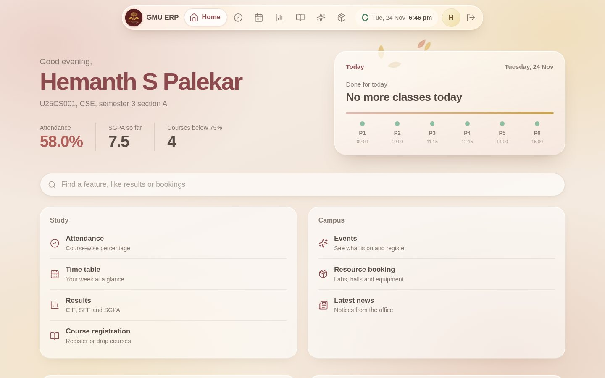

# ui-designs

A personal library of UI designs. Each design is a **brief with exact numbers, design tokens, screenshots and ready-to-paste prompts**, so I can recreate the same look in a new project, or hand it to an AI and get something very close.

## Designs

<!-- DESIGNS:START -->
| | Design | Tags | Stack | Status |
|---|---|---|---|---|
|  | **[GMU ERP glass](designs/gmu-erp-glass)**<br>Soft, light glassmorphism for a college ERP: cream wallpaper, maroon and gold, a floating island nav, plain big figures, light panels, falling leaves. | glassmorphism, light-mode, dashboard, erp, island-nav, mobile-first-adapted | React, TypeScript, Vite, Framer Motion, Lucide, react-snowfall | shipped |
<!-- DESIGNS:END -->

## How a design is organised

```
designs/<slug>/
├── README.md        what it is, a hero screenshot, how to use it
├── brief.md         the deep brief: principles, tokens, every component with specs, motion, responsive, performance, checklist
├── prompt.md        ready-to-paste prompts (full, short, adapt to another domain)
├── tokens.css       copy-paste design tokens
├── design.json      metadata (name, tags, stack, palette, status) used for the index above
├── screenshots/     numbered screens, desktop and phone
└── reference/       real code the design was built from (optional, reading only)
```

```
templates/design-template/   copy this to start a new design
docs/how-to-add-a-design.md  the steps, naming, and a checklist before going public
scripts/update-index.py      rebuilds the Designs table above from every design.json
```

## Use a design in a new project
1. Copy the design's `tokens.css` into the project and import it first.
2. Paste its `prompt.md` into your AI tool and attach `brief.md`.
3. Check the result against the checklist at the end of `brief.md`.

## Add a design
```bash
cp -r templates/design-template designs/my-new-design
# fill in the files, add screenshots, then:
python3 scripts/update-index.py
```
Full steps: [docs/how-to-add-a-design.md](docs/how-to-add-a-design.md).

## Status
Private for now. See "Before making the repo public" in the how-to before changing that.
