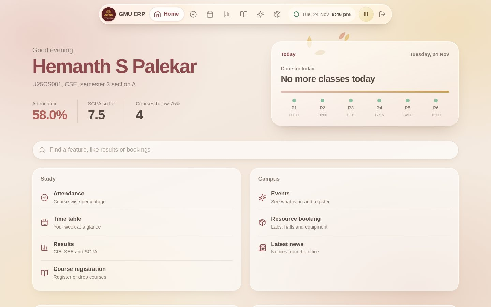
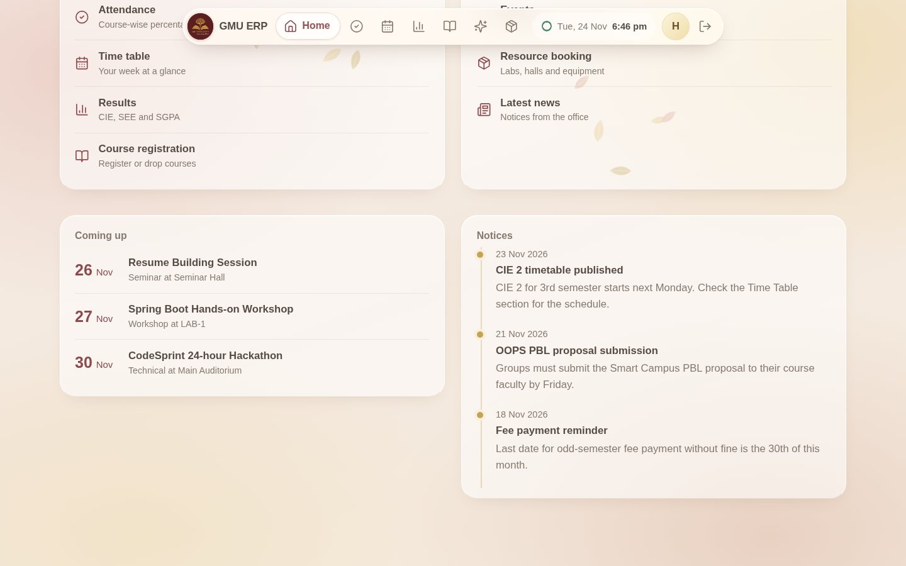
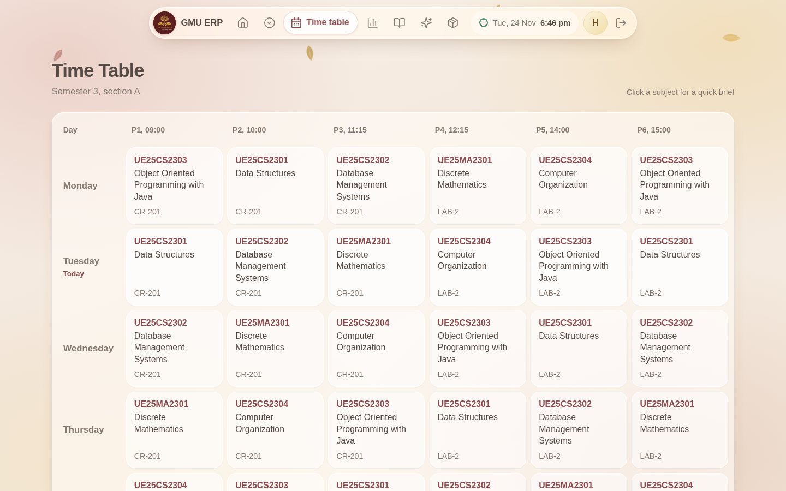
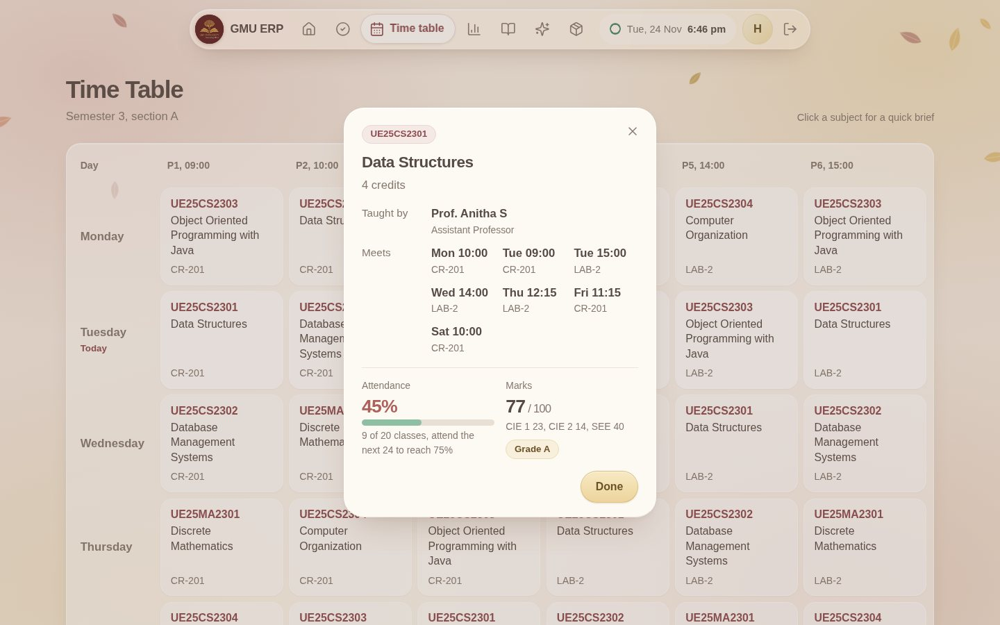
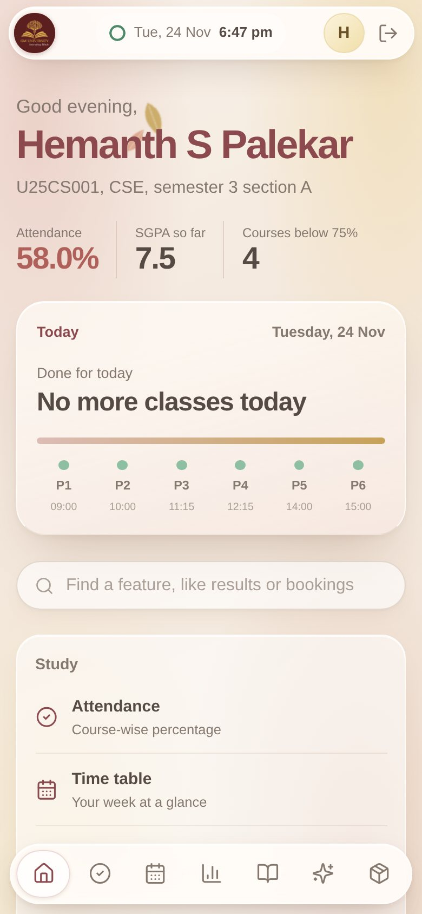

# GMU ERP glass

Soft, light glassmorphism for a college ERP: a warm cream wallpaper with faint blush and gold light, maroon and gold accents, a floating "island" navigation pill, plain big figures instead of boxes, light rounded panels, spring motion and a few leaves drifting behind everything.

| | |
|---|---|
| Mood | soft, light, calm, warm. Light mode only |
| Palette | cream `#f6f2ec`, maroon `#8c4a4e`, gold `#c6a258`, text `#564a44` |
| Stack | React, TypeScript, Vite, Framer Motion, Lucide, react-snowfall |
| Works on | desktop and phone (bottom tab bar, cards instead of tables) |
| Source | https://github.com/neonjava/gmu-erp |

## What is in this folder
| File | What it is |
|---|---|
| `brief.md` | The deep brief: principles, every token, every component with exact numbers, motion, responsive rules, performance lessons, checklist |
| `prompt.md` | Ready-to-paste prompts (full, short, and "adapt to another domain") |
| `tokens.css` | Copy-paste design tokens, wallpaper, base type and the glass panel |
| `screenshots/` | Desktop and phone screens (numbered) |
| `reference/` | The real stylesheets and React components this was built from, for reading and copying |
| `design.json` | Metadata used to build the index in the top-level README |

## Use it in a new project
1. Copy `tokens.css` into the project and import it first.
2. Paste `prompt.md` (section 1) into your AI tool and attach `brief.md`.
3. Point it at `reference/components/` if you want the same structure for the island, Today card or pop-ups.
4. Check the result against the checklist at the end of `brief.md`.

## Screens

