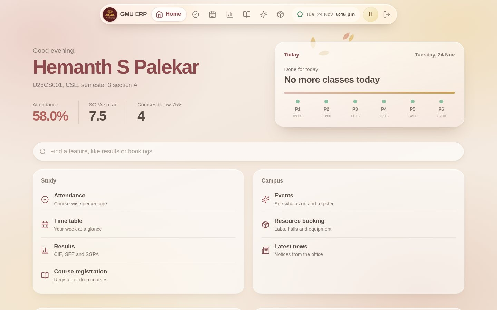
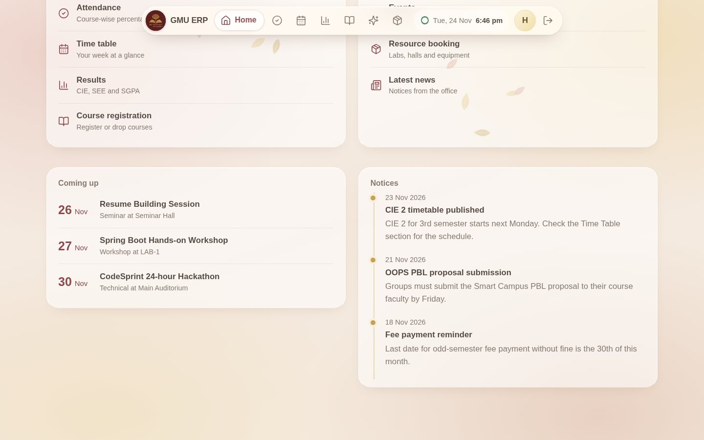
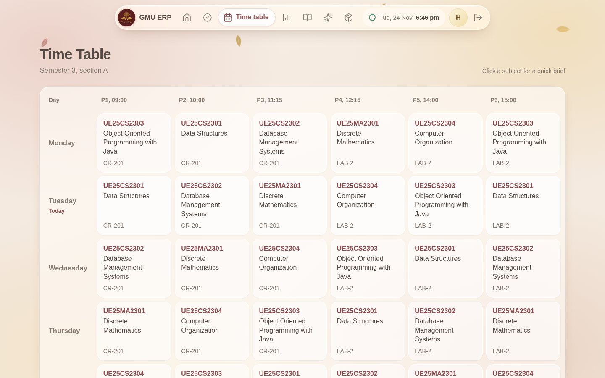
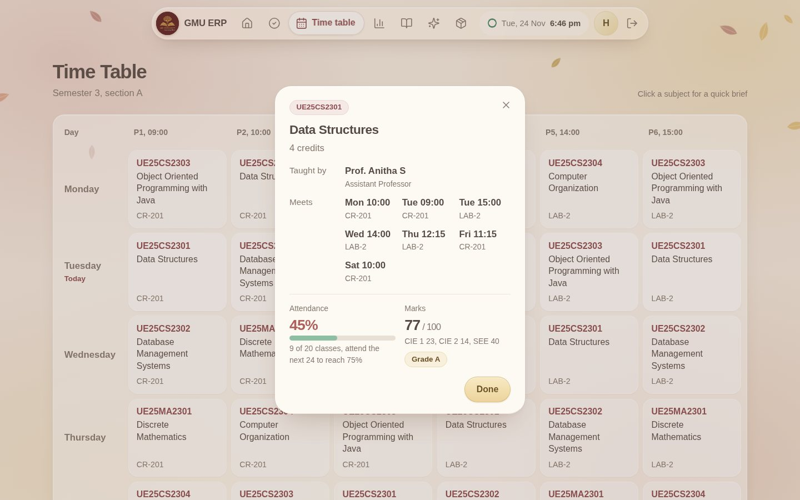
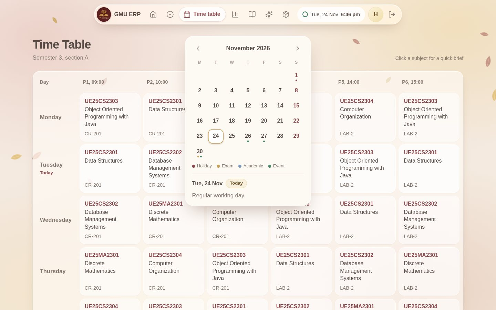
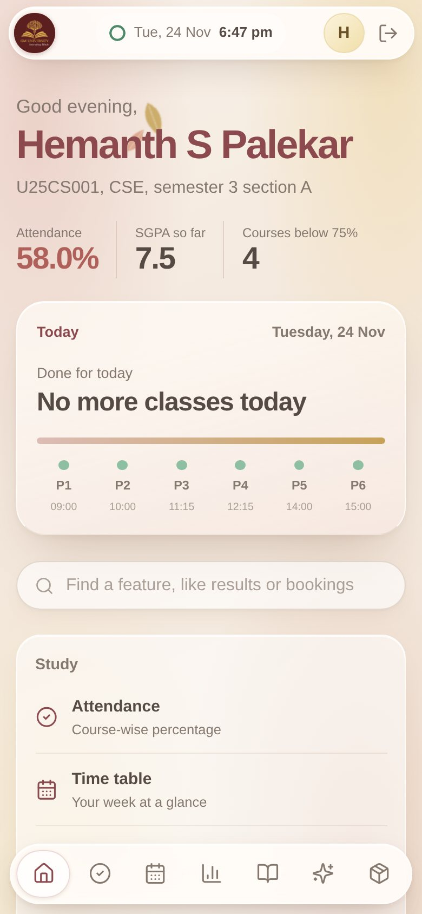
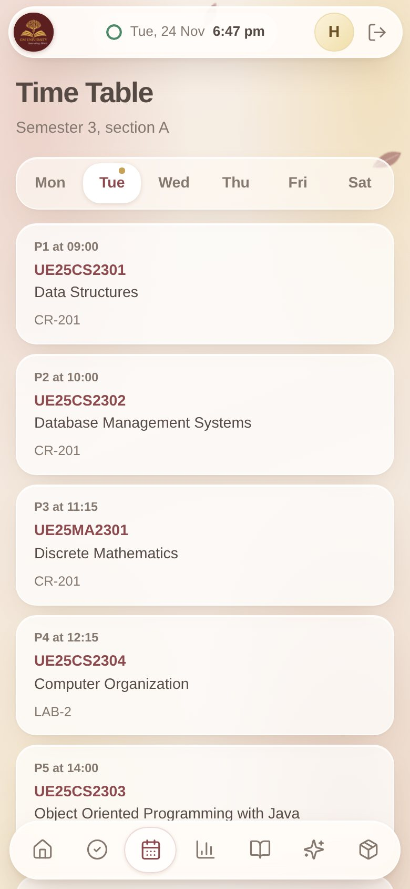

# GMU ERP UI: the full design brief

Everything needed to rebuild this look in another project, or to give an AI a prompt that produces something very close.
Source project: `neonjava/gmu-erp` (React + TypeScript on a Spring Boot backend). Every number below was taken from the real code.

Screens for reference are in `screenshots/` (links at the bottom). Working code is in `reference/`. Copy-paste tokens are in `tokens.css`.

---

## 1. The idea in one paragraph

A **soft, light glassmorphism** interface for a college ERP. A warm cream "wallpaper" of faint blush and gold light sits behind everything. Content lives on **translucent, rounded, warm-white panels** with a white edge and a soft warm shadow. Navigation is a **floating pill ("island")** at the top, in the style of a Dynamic Island: icon tabs, the current tab opens to show its name, and a white highlight glides between tabs. A few **faint maroon and gold leaves** drift down behind the content. Accents are the university's **maroon and gold**. Everything is calm, low-contrast and gently animated with springs.

It is a **website**, not a desktop app: no window title bars, no traffic-light dots.

### What it is NOT (rules learned the hard way from the client's feedback)
| Do not | Why |
|---|---|
| Dark mode, dark panels, neon | The client hates dark themes. Light only. |
| High contrast or pure black text | The client dislikes high contrast. Text is warm brown `#564a44`. |
| Mac-window chrome (the three coloured dots, a fake title bar) | "This is a web ERP, not an application." |
| "Coming soon" tiles or cards | Remove anything that does nothing. Add features when they exist. |
| A grid of identical boxes for everything | Home is an airy directory (icon rows), plain big numbers, an agenda list and a timeline, with only a few real cards. |
| Copying another app's look | The layout should feel original, even though the mood came from island-style UI references. |
| Zoomed-out, tiny UI | Sizes scale up on big screens (root font 15px to 19px). |
| Blur on large panels while something animates behind them | Caused about 10 frames per second (see section 11). |
| A button or icon that does nothing | An empty leaf toggle button was removed for this reason. |

---

## 2. Principles

1. **Soft over sharp.** Light backgrounds, warm greys, muted status colours, big radii.
2. **One memorable thing per screen.** Home: the huge maroon name and the Today card. Everything else is quiet.
3. **Structure without boxes.** Use whitespace, thin dividers and icons. Use a card only when the thing is a real object (Today card, a panel that groups a list, a table).
4. **Things you can click look clickable** (lift on hover, arrow slides in) and **things that cannot do not pretend to** (no dead buttons).
5. **Motion explains change.** Pages fade and slide a few pixels, the island stretches, pop-ups spring in. Nothing moves just to decorate except the leaves.
6. **Same on every screen size, adapted not shrunk.** Phones get a different layout (cards, bottom tab bar), not a squeezed desktop.
7. **Fast.** No images for decoration, no web fonts, no big blur layers. Pages never flash empty.
8. **Plain words.** Sentence case, active verbs, no jargon, no all caps.

---

## 3. Design tokens

All colours are CSS variables. Full file: `tokens.css`.

### Colour
| Token | Value | Use |
|---|---|---|
| `--maroon` | `#8c4a4e` | names, active tab, links, code labels |
| `--maroon-tint` / `--maroon-line` | `#f5e9e6` / `#ead6d2` | tag pills, Today card edge |
| `--gold` | `#c6a258` | focus, today marker, timeline dots |
| `--gold-tint` / `--gold-line` | `#f8f0dc` / `#ecdcb2` | tags, rings |
| `--gold-grad` | `linear-gradient(135deg,#fbf3dc,#f1dfaa)` | avatar, primary button base |
| `--bg` | `#f6f2ec` | page |
| `--surface` / `--surface-2` / `--surface-3` | `#fcfaf6` / `#f2ece4` / `#e8e0d5` | solid cards, inputs, bar tracks |
| `--border` / `--border-strong` | `#e7dfd4` / `#d9cfc2` | hairlines |
| `--text` | `#564a44` | body (never black) |
| `--text-2` | `#85786f` | secondary |
| `--text-3` | `#aa9f96` | faint, placeholders |
| `--on-gold` | `#6a5226` | text on gold |
| `--ok` / `--ok-bg` / `--ok-line` / `--ok-bar` | `#4e8a6a` / `#e8f2ec` / `#cfe3d7` / `#8fbfa3` | success, "in class now", good attendance |
| `--danger` / `--danger-bg` / `--danger-line` / `--danger-bar` | `#b0605a` / `#f8ebe8` / `#ecd2cd` / `#d9a09a` | shortage, errors, delete |

### Glass (the panel material)
| Token | Value |
|---|---|
| `--glass` | `rgba(255,251,246,.66)` |
| `--glass-strong` | `rgba(255,251,246,.78)` |
| `--glass-soft` | `rgba(255,255,255,.34)` |
| `--glass-line` (edge) | `rgba(255,255,255,.72)` |
| `--glass-edge` (bottom edge) | `rgba(160,125,100,.14)` |
| `--glass-shadow` | `inset 0 1px 0 rgba(255,255,255,.8), 0 1px 2px rgba(120,85,60,.05), 0 12px 32px -14px rgba(120,85,60,.24)` |
| `--glass-lift` (hover, hero) | `inset 0 1px 0 rgba(255,255,255,.85), 0 2px 6px rgba(120,85,60,.06), 0 24px 48px -20px rgba(120,85,60,.32)` |
| `--blur` | **`none`**. Panels are NOT blurred (performance). Only the island and the phone bottom bar blur. |

A glass panel is: translucent fill, 1px white border (the bottom border slightly brown), an inset 1px white highlight on top, and a long soft warm shadow.

### Shape
| Token | Value | Use |
|---|---|---|
| `--r-xl` | `1.75rem` | hero card, login card, pop-ups |
| `--r-lg` | `1.25rem` | tables, cards |
| `--r-md` | `.85rem` | inputs |
| `--r-pill` | `999px` | buttons, nav, tags, search |
| panels | `1.5rem` | light content panels on Home |
| blocks | `1rem` | time table blocks |

### Typography
- Family: `-apple-system, BlinkMacSystemFont, "SF Pro Text", "Segoe UI Variable Text", "Segoe UI", Inter, Roboto, "Helvetica Neue", Arial, sans-serif`. No web fonts.
- Root size: `clamp(15px, 12.5px + .29vw, 19px)`; everything else in `rem`, so the UI grows on large screens (about 18px on a 1920 monitor).
- Body `1rem / 1.55`, colour `--text`.
- `h1` `2.1rem`, weight 700, tracking `-.03em`, line-height 1.15.
- Hero name `clamp(2.3rem, 1.2rem + 2.6vw, 3.7rem)`, weight 750, tracking `-.04em`, line-height 1.04, colour maroon.
- Section labels (Study, Campus, Coming up): `.95rem`, weight 650, `--text-2`, **sentence case, not uppercase**.
- Big numbers: `2.3rem`, weight 700, tracking `-.035em`, `font-variant-numeric: tabular-nums`.
- Small text `.85rem`.

### Motion
- Easing `--ease: cubic-bezier(.2,.8,.2,1)`; springy hover `--spring: cubic-bezier(.34,1.4,.64,1)`.
- Framer Motion springs: pop-ups and toasts `stiffness 520, damping 34`; calendar `520 / 36`; island layout glide `420 / 38`; active-tab pill `480 / 36`.
- Page change: `opacity 0 to 1`, `y 10px to 0`, `.24s`, ease above; old page exits `.11s` (`opacity 0, y -4px`); mode `wait`.
- Hover lift on clickable blocks: `translateY(-2px)` with the spring ease. Press: `scale(.96)` on buttons, `.985` on blocks.
- All animation off under `prefers-reduced-motion` (CSS animations killed; leaves not rendered).

### Spacing and layout
- Page container: `max-width 78rem`, padding `2.25rem 1.5rem 5rem`, centred.
- Gaps: `.75rem` to `1rem` between small things, `1.6rem` between panels, `2.5rem` in the hero.
- Z-index: leaves `-1`, island `20`, phone bottom bar `22`, toasts `30`, calendar `25`, modal backdrop `40`.

---

## 4. Background and leaves

**Wallpaper** (one fixed layer, `body::before`, `z-index:-2`): four radial blobs over a cream linear gradient.
```
radial-gradient(55% 60% at 8% 12%,  rgba(226,186,178,.55), transparent 70%)   /* blush, top left */
radial-gradient(50% 55% at 92% 8%,  rgba(238,214,160,.55), transparent 70%)   /* gold, top right */
radial-gradient(60% 60% at 85% 95%, rgba(214,170,150,.42), transparent 70%)   /* clay, bottom right */
radial-gradient(55% 50% at 15% 95%, rgba(240,222,180,.5),  transparent 70%)   /* wheat, bottom left */
linear-gradient(160deg, #f8f1e8 0%, #f3e7dc 50%, #f6eee2 100%)
```

**Falling leaves** (a full-screen canvas behind the content, on every page including sign-in, `pointer-events:none`):
- Library: `react-snowfall`, given custom *leaf images* instead of snowflakes.
- Each leaf image is drawn once on a 64px canvas: a pointed leaf shape (two quadratic curves) with a thin white midrib, rotated 36 degrees.
- Five tints: `rgba(198,162,88,.85)`, `rgba(140,74,78,.55)`, `rgba(214,150,120,.75)`, `rgba(224,186,110,.8)`, `rgba(170,100,90,.6)`.
- Count `clamp(12, innerWidth/70, 30)`; radius `22 to 42`; speed `.7 to 1.7`; wind `-.4 to 1.2`; rotation `-1.2 to 1.2`.
- Not rendered when the user prefers reduced motion.
- Panels sit over the leaves, so panels must be fairly solid (alpha `.56` to `.66`) or the leaves show through sharply.

---

## 5. Components (anatomy, specs, behaviour)

### 5.1 The island (top navigation)
- A floating pill: `position: sticky; top: .75rem; width: fit-content; margin: .75rem auto 0; padding: .4rem; border-radius: 999px; gap: .35rem`.
- Fill `rgba(255,251,246,.62)` with `backdrop-filter: saturate(180%) blur(24px)`; 1px white edge; shadow `inset 0 1px 0 rgba(255,255,255,.85), 0 14px 34px -14px rgba(110,70,50,.32), 0 2px 6px rgba(110,70,50,.06)`.
- Contents, left to right: **logo** (round, 2.5rem) + wordmark "GMU ERP"; **tabs**; **clock button**; **avatar** (initial on the gold gradient, links to profile); **sign out** icon button.
- **Tabs:** icon + label, height `2.6rem`, padding `0 .75rem`, pill, font `.95rem/600`, colour `--text-2`. Only the **current tab shows its label**; the others are icon only and show a tooltip label on hover.
- **Active tab:** colour maroon; a white pill (`rgba(255,255,255,.82)`, shadow `0 1px 3px rgba(120,85,60,.14)`, 1px inset line `rgba(234,214,210,.9)`) sits behind it and **glides to the new tab** (Framer Motion shared `layoutId`). The island width animates as the label moves (layout spring).
- Tabs depend on role. Student: Home, Attendance, Time table, Results, Registration, Events, Resources. Faculty: My courses, Time table. Admin: Students, Faculty, Courses, Time table, Notices. Everyone: Events, Resources.
- **Hovering a tab starts loading its data** (prefetch) so the page appears instantly.
- **Clock button:** a soft pill (`rgba(255,255,255,.45)`, height 2.6rem) with a **progress ring**, the date ("Tue, 24 Nov") and time in bold tabular numerals. The ring (1rem, conic-gradient green on grey, masked into a ring) fills across the college day 09:00 to 16:00. **Clicking it opens the calendar.**
- Brand name and date text hide below 1150px width to save room.

### 5.2 Calendar popover (from the clock)
- 22rem wide, solid cream `#fdf9f3`, radius `1.5rem`, big soft shadow, springs in from the clock, closes with Esc or a click outside.
- Header: previous and next month arrows, "November 2026".
- Monday-first month grid. Today has a gold ring; the picked day is a white raised chip; Sundays and holidays are maroon.
- **Colour dots under dates:** holiday = maroon, exam = gold, academic = blue `#7d97b8`, event = green. A legend sits below the grid.
- Selecting a day shows its entries underneath ("Regular working day." or "Sunday, no classes." when empty). Event entries link to the event.
- Admin only: an "Add to this date" field (title + type) and a small x to remove entries.
- Data: fixed-date public holidays are pre-filled; moving festivals are added by the admin.

### 5.3 Home hero
- Two columns: text left (`1.2fr`), Today card right (`1fr`, min `19rem`); gap `2.5rem`. One column below 900px.
- Small greeting ("Good evening,") in `--text-2`, **huge maroon name**, a one-line subtitle (USN, department, semester).
- The greeting follows the **visitor's own clock**, not the server's.
- **Figures** (key numbers) are **plain text, no boxes**: label small and grey above, number large below, separated by thin vertical lines `rgba(160,125,100,.22)`. A figure under its threshold turns red (attendance below 75%).
- While data loads, the same shape shows with grey placeholders so nothing jumps.

### 5.4 Today card (the one prominent card)
- Padding `1.5rem 1.6rem 1.35rem`, radius `1.75rem`, background `linear-gradient(165deg, surface 30%, maroon-tint 140%)`, border `maroon-line`, `--glass-lift` shadow.
- Header row: "Today" (maroon, bold) left, "Tuesday, 24 Nov" right.
- Then a small label ("In class now", "Next class", or "Done for today"), the **class name at 1.6rem/700**, then the time (maroon, bold), room, and a **live countdown** in green ("25 min left" or "in 1 h 15 min").
- A thin **day progress bar** (0.4rem, gradient `#dcbcb6` to gold).
- A row of **period dots P1 to P6** with times: done = soft green; now = solid green with a soft ring; next = gold with a gold ring. Dots are clickable and open the subject pop-up.
- Class length is 55 minutes; day window 09:00 to 16:00. Updates every 30 seconds.

### 5.5 Search pill
- Full-width pill, height `3.3rem`, soft shadow, magnifier icon inside left. Filters the directory live. Empty result: "Nothing matches 'x'. Try a shorter word, like 'marks' or 'room'."

### 5.6 Light panels on Home
Each group (Study, Campus, Coming up, Notices) sits on one light block:
- Padding `1.1rem 1.4rem 1rem`, radius `1.5rem`, fill `rgba(255,255,255,.56)`, 1px white border (bottom `rgba(160,125,100,.14)`), inset top highlight, shadow `0 10px 28px -16px rgba(120,85,60,.22)`. No blur.
- Laid out with `grid-template-columns: repeat(auto-fit, minmax(19rem, 1fr))`, gap `1.6rem`.
- **Directory rows** (Study, Campus): a maroon line icon (1.35rem), bold title, a one-line grey note, thin divider `rgba(160,125,100,.14)` between rows. On hover the row gets `rgba(255,255,255,.5)` and a chevron slides in from the left.
- **Agenda** (Coming up): a big maroon day number with the month small beside it, then bold title and a grey "Category at Venue" line.
- **Notice timeline:** a 2px gold line (`rgba(198,162,88,.35)`) down the left, a gold dot (0.6rem with a 0.25rem gold-tint ring) per notice, small grey date, bold title, grey body.

### 5.7 Tables
- Container is a glass panel (radius `1.25rem`). Header row tinted `rgba(255,255,255,.38)`, labels `.85rem/650` grey. Row hover tints white. Numeric columns right-aligned tabular. Rows below a threshold get a light red wash.
- Attendance: code, course name (clickable), attended, total, %, a thin bar, a status tag ("OK" green, "Short, attend the next 24" red).
- Rows and course names open the **subject pop-up**.
- **On phones each row becomes a card** (see section 7).

### 5.8 Time table
- A CSS grid (not a `<table>`): first column `7rem` for the day, then six columns `minmax(9.5rem, 1fr)`, gap `.5rem`.
- Each subject is a **block that fills its whole cell**: radius `1rem`, fill `rgba(255,255,255,.5)`, 1px white border, tiny shadow. Inside: code (maroon, bold), course name, room at the bottom in small grey.
- Hover: solid white, gold border `rgba(198,162,88,.45)`, lift 1px, bigger shadow. Click opens the subject pop-up.
- Today's row label shows a small maroon "Today"; its blocks are slightly whiter.
- A grid is used on purpose: stretching blocks to row height does not work reliably in `<table>` cells in Firefox.
- Empty periods show a faint dash.

### 5.9 Subject pop-up ("brief")
- Opens from time table blocks, attendance/results/registration rows, and the Today card (class name and dots).
- Centred modal, width `min(27rem, 100%)`, solid cream `#fdf9f3`, radius `1.75rem`, `--glass-lift` shadow, the page behind dims and softly blurs. Springs in (scale .95 to 1, y 18 to 0). Closes with Esc, a click outside, the round **x** top right, or **Done**.
- Content: course code pill (maroon tint), name (`1.35rem/700`), credits.
- Facts list: **Taught by** (name + designation), **Meets** (a compact 3-column grid, "Mon 10:00" with room beneath; 2 columns on phones).
- A divider, then two "standing" blocks side by side: **Attendance** (big %, thin bar, "9 of 20 classes, attend the next 24 to reach 75%") and **Marks** (big total over max, "CIE 1 23, CIE 2 14, SEE 40", grade pill).
- Never taller than the window: it scrolls inside itself on short screens; the page behind stops scrolling.
- Data is fetched fresh on each open.

### 5.10 Confirm sheet
- Replaces the browser's confirm box. Small solid cream card near the top of the window, one sentence of plain language, **Cancel** and an action button named for what it does ("Reset password", "Turn off", "Delete").
- Destructive actions get a soft red button, not the gold primary. Esc cancels.

### 5.11 Toasts
- Appear **under the island**, centred, `min(34rem, 100% - 2rem)`, solid warm white, radius `1.1rem`, a coloured dot then text.
- Drop in with a spring from slightly above. **Success hides itself after 4.5 seconds; errors stay until clicked.** Max three at once.

### 5.12 Buttons
- Pill, `font .95rem/600`, padding `.6rem 1.25rem`; small variant padding `.35rem .9rem`.
- Default: white-to-cream vertical gradient, 1px border `rgba(190,170,150,.38)`, tiny shadow, top inner highlight.
- **Primary: gold** gradient `#f8e9c4 to #ecd49b`, border `rgba(198,162,88,.5)`, text `#6a5226`.
- Danger (quiet): red text; sheet confirm button gets a pale red fill.
- Press shrinks to `scale(.96)`. Full-width variant for sign-in.

### 5.13 Fields
- Radius `.85rem`, fill `rgba(255,255,255,.62)`, border `rgba(190,170,150,.4)`, inset shadow, padding `.7rem .95rem`.
- Focus: border turns gold, plus a soft gold ring `0 0 0 .22rem rgba(198,162,88,.26)`.
- Password field has a **Show/Hide** text button inside, a **Caps Lock** warning, and a **strength meter** (bar + word: "Weak, add more characters", "Okay", "Strong", "Very strong") when choosing a new password.

### 5.14 Small pieces
- **Toggle switch:** 2.6rem x 1.55rem pill, white knob that springs across, on-colour `--ok-bar`.
- **Segmented control** (filters): a glass pill container; the selected segment is a raised white pill; each option can carry a status dot and a count.
- **Tags:** pill, `.8rem/650`, gold tint by default; variants: maroon (`solid`), green (`ok`), red (`danger`).
- **Status:** a dot plus a word, never colour alone: Active (green), Needs new password (gold), Locked (red), Turned off (grey).
- **Progress bar:** `.5rem`, pill, track `--surface-3`, fill `--ok-bar` (red when short).
- **Avatar:** circle on the gold gradient with the first letter.

### 5.15 Sign-in screen
- Centred card `min(29rem, 100%)`, radius `1.75rem`, no title bar. Above the title, the **university logo** as a rounded square (5.6rem, radius 1.4rem, soft maroon shadow). Title "Welcome back" at `2.5rem/750`.
- Fields "USN or employee ID" and "Password" (Show/Hide), a toggle "Keep me signed in for a week", a full-width gold **Sign in** button.
- Demo chips (Student, Faculty, Admin) that fill the fields.
- Error messages are specific: wrong password plus "N tries left before the account locks" when 3 or fewer remain, locked for 15 minutes, or sign-in turned off.
- A small floating island at the top shows the logo and "GM University". Leaves fall behind.

### 5.16 First sign-in and profile
- First sign-in (or after an admin reset) shows **only** a "Choose your own password" card until a new password is set.
- Profile: big avatar, name, role tag, last sign-in time; two glass panels side by side: Details (definition list) and Change password.

### 5.17 Admin: student accounts
- Search field + "Add student". A segmented filter: All, Active, Needs new password, Locked, Turned off, each with a count.
- Table (cards on phones): USN, name and email, dept, semester, section, status word with dot, last signed in, and actions: **Edit, Unlock (only if locked), Reset password, Turn off / Turn on, Delete**. Reset, turn off and delete ask first in a confirm sheet.

---

## 6. Content and voice

- Sentence case everywhere. No ALL CAPS labels. No em-dash decoration.
- Name things by what the person will understand: "Course registration", "Time table", "Latest news".
- Buttons say what they do ("Save password and continue", "Reset password", "Turn off") and the toast repeats the same verb.
- Errors say what happened and what to do next. They do not apologise.
- Empty states invite action or give a useful fact ("Regular working day.").
- College vocabulary stays: USN, CIE, SEE, SGPA, semester, section, periods P1 to P6.

---

## 7. Responsive behaviour

| Width | Behaviour |
|---|---|
| above 1150px | Full island with brand name and clock date. |
| 1150px and below | Brand name and the clock's date text hide. |
| 900px and below | Hero becomes one column. |
| **720px and below (phone mode)** | See below. |
| 359px and below | Clock date hides; bottom bar gets tighter. |

**Phone mode** (everything is inside `@media (max-width: 720px)`, so laptops and desktops are untouched):
- **Top:** a slim full-width header: logo, the date and time (still opens the calendar), avatar, sign out. No blur on it (a blurred parent traps fixed children).
- **Bottom:** the tabs become a **floating pill bar fixed to the bottom** (`left/right .6rem`, `bottom .6rem + safe-area`), icons only, each tab `flex: 1`, current tab highlighted with the white pill. Fits eight tabs on a 320px phone. Fill `rgba(255,251,246,.94)` with blur.
- **Tables:** each row is a card (grid, 3 columns): small maroon code, bold course title, then labelled values (label tiny grey above, value below), full-width bar and status. Cards use the same glass material.
- **Time table:** day tabs (Mon to Sat, today pre-selected with a gold dot); only that day's blocks show, each as a card with "P1 at 09:00" on top.
- **Filters** wrap onto two lines rather than hide.
- **Pop-ups:** 0.75rem from the edges, max height of the window, scroll inside.
- **Inputs use 16px text** so phones do not zoom in on tap. Buttons get a larger tap target.
- Content gets extra bottom padding (`6.5rem + safe-area`) so the bar never covers it.
- Tablets (768px) keep the desktop layout.

**How desktop was protected:** every phone rule lives in the media query; extra helper elements (day tabs, in-block time labels) are hidden by default; the build was verified by taking screenshots of every page at 1920 and 1366 wide before and after and comparing pixel by pixel (only clock text and spring-animation noise differed).

---

## 8. Motion catalogue

| Thing | What happens |
|---|---|
| Page change | Old page fades out (.11s), new page fades in and slides up 10px (.24s). Scroll resets to top. |
| Island | Width stretches as the label moves; white pill glides to the new tab. |
| Hover on directory row | Background tint; chevron slides in. |
| Hover on a block | Lifts 1 to 2px, shadow grows, border turns gold. |
| Pop-up | Backdrop fades; card springs in (scale .95 to 1). |
| Toast | Drops from above with a spring; success fades after 4.5s. |
| Calendar | Springs down from the clock. |
| Today card | Countdown and dots update every 30 seconds. |
| Leaves | Slow drift, gentle sway and rotation. |
| Button press | Shrinks to 96%. |

---

## 9. Page structure (student)

Home: island, hero (greeting, name, subtitle, figures | Today card), search, directory panels (Study | Campus), then Coming up | Notices.
Attendance, Results, Registration: page title + one-line explainer, then one glass table.
Time table: title, then the block grid.
Profile: header, then Details | Change password.
Admin Students: title, search and add, filter segments, table.

---

## 10. Accessibility

- Visible keyboard focus (gold ring). Icon buttons have `aria-label`s. Tabs use `aria-current="page"`; filters use `role="tab"` / `aria-selected`.
- Pop-ups: `role="dialog"` (`alertdialog` for confirm), Esc closes, focus moves to the primary action, page scroll locks while open.
- Status is never colour alone (dot plus word).
- Reduced motion respected (no leaves, no CSS animation).
- Contrast is intentionally soft; body text `#564a44` on cream is still above 7:1, secondary text is the softest allowed.

---

## 11. Performance lessons

1. **Do not blur panels while something animates behind them.** With the leaves moving, every blurred panel re-rendered every frame. Measured on Home: **94 ms per frame with blur, 23 ms without**; worst frame in a tab switch fell from 217 ms to 50 ms. Fix: `--blur: none` on panels and slightly more solid fills. Blur stays only on the small island and phone bar.
2. **Show data instantly.** Cache each API answer by URL, show the last answer immediately and refresh in the background; start loading a tab's data when the pointer is over it; start loading Home during sign-in. Clear the cache on sign-out or user change.
3. **No layout jump while loading.** Reserve the Today card and figures with grey placeholders; compute the greeting on the client.
4. **Use a CSS grid for the time table**, not table cells with forced heights (Firefox).
5. No images except the logo, no web fonts, one wallpaper layer painted once.
6. Tell the browser not to cache the app shell stale (`Cache-Control: no-cache` on static files) so updates show on a normal refresh.

---

## 12. Tech and architecture notes

- **Frontend:** React 18, TypeScript, Vite, React Router, Framer Motion, Lucide icons, `react-snowfall`. Hand-written CSS, no component library, no Tailwind.
- **Backend:** Spring Boot (Java), JSON API under `/api`, CSRF token in a cookie sent back as `X-XSRF-TOKEN`, session cookie, form login returning JSON.
- App is served under `/app`; Maven builds the frontend into the jar.
- **Static preview for GitHub Pages:** a build mode that answers API calls from saved JSON files, uses hash routing, blocks writes with a friendly "read-only preview" message.
- Data shape per page is one small JSON call (dashboard, attendance, results, time table, registration, subjects, notices, calendar month, admin students).
- Sign-in rules shown in the UI: first sign-in forces a new password; 5 wrong passwords lock the account for 15 minutes; admin can unlock, reset, turn off or on.

---

## 13. Prompts

### 13.1 Full prompt (paste into a new project)
```
Build the UI in a soft, light glassmorphism style for a college ERP web app (a website, not a desktop-app look: no window title bars or traffic-light dots).

Palette: warm cream background #f6f2ec with a fixed "wallpaper" of faint blush and gold radial gradients; accents maroon #8c4a4e and gold #c6a258; text #564a44 (never pure black, low contrast, light mode only). Status colours are muted: green #4e8a6a, red #b0605a.

Material: panels are translucent warm white rgba(255,251,246,.66) with a 1px white border (bottom edge slightly brown), an inset top highlight, a soft warm shadow, and 1.25 to 1.75rem radius. Do NOT use backdrop-filter blur on large panels, because animated content behind them makes the page stutter; make panels slightly more solid instead. Blur is allowed only on small elements like the nav.

Navigation: a floating pill "island" at the top with logo, icon-only tabs where the current tab expands to show its label, and a white highlight pill that glides between tabs (Framer Motion shared layoutId, spring). Hovering a tab prefetches its data. A clock with a day-progress ring opens a mini month calendar (holidays maroon, exams gold, events green; admin can add or remove dates). On phones: a slim top header and a floating bottom tab bar with icons only that fits 8 tabs at 320px.

Home: a small greeting, a huge maroon name (clamp 2.3 to 3.7rem, weight 750, tracking -.04em), a one-line subtitle, key numbers as plain large figures with thin dividers (no boxes; turn red under a threshold), and one prominent "Today" glass card with the next class, a live countdown, a day progress bar and P1 to P6 dots. Below: a pill search that filters the feature directory, light rounded panels (Study, Campus) of icon rows with one-line notes and thin dividers (a chevron slides in on hover), then an agenda list (big date, title, venue) and a notice timeline with gold dots. No "coming soon" items, no dead buttons.

Data screens: tables inside a glass container with a tinted header and clickable course names; on phones each row becomes a card. The weekly time table is a CSS grid whose blocks each fill their whole cell (not a table), with hover lift; on phones show one day at a time with day tabs. Clicking any subject opens a centred solid-cream pop-up with code, name, credits, teacher, weekly meeting times, attendance (big %, bar, how many classes to reach 75%) and marks (CIE, SEE, grade); it has a round x, Done, closes on Esc or outside click, never exceeds the window height.

Controls: pill buttons (primary is a gold gradient #f8e9c4 to #ecd49b with text #6a5226), inset rounded fields with a gold focus ring, toggle switch, segmented filter with counts and status dots, tag pills, thin progress bars, a confirm sheet instead of browser confirm (destructive actions in soft red), and toasts that drop under the island (success auto-hides after 4.5s, errors stay).

Sign-in: a centred card with the university logo as a rounded square, "Welcome back", fields, show/hide password, caps-lock warning, "keep me signed in" switch, gold Sign in button, demo account chips, and specific errors (tries left, locked 15 minutes, turned off). First sign-in forces choosing a new password.

Type and scale: system font stack, sentence case (no all caps), tabular numbers, rem units with a fluid root font-size clamp(15px, 12.5px + .29vw, 19px), 16px inputs on phones. Motion: spring easing, pages fade and slide 10px in .24s, pop-ups spring in, everything off under prefers-reduced-motion. Add a few faint maroon and gold leaves drifting behind the content on a canvas (react-snowfall with custom leaf images), off for reduced motion.

Performance: cache API answers and show them instantly while refreshing, reserve space with placeholders so nothing jumps, no decorative images, no web fonts.

Stack: React, TypeScript, Vite, React Router, Framer Motion, Lucide icons, hand-written CSS with design tokens as CSS variables.
```

### 13.2 Short prompt
```
Soft light glassmorphism college-ERP web UI: cream #f6f2ec wallpaper with faint blush/gold gradients, maroon #8c4a4e + gold #c6a258 accents, text #564a44, translucent warm-white rounded panels (no blur on big panels), floating pill "island" nav with a gliding white active pill, clock that opens a mini calendar, huge maroon name + plain big-number stats + one "Today" next-class card, icon-row directory panels, agenda and notice timeline, tables that become cards on phones, full-cell time-table blocks, subject pop-ups, spring animations, faint falling leaves, no dark mode, no window dots, no "coming soon". React + TS + Framer Motion + Lucide.
```

### 13.3 Adapt to another domain
```
Use the design system in erp-ui.md (soft light glassmorphism, island nav, plain figures, light panels, spring motion) for a <HOSPITAL / SHOP / GYM> dashboard. Keep the tokens and component rules, but change the accents to <COLOURS>, the logo, and the content. Home needs: greeting + name, three key figures, one prominent "next up" card, a feature directory, an agenda list and a notice timeline.
```

---

## 14. Checklist before calling it done

- [ ] Light only; nothing pure black; no high-contrast blocks.
- [ ] No window dots or fake title bars; pop-ups have a plain x.
- [ ] No dead buttons, no "coming soon" items.
- [ ] Panels have no blur; island and phone bar do.
- [ ] Home is airy: figures without boxes, one prominent card, light panels for groups.
- [ ] Time table blocks fill their cells in Firefox and Chrome.
- [ ] Every subject, row and dot that mentions a course opens the same pop-up.
- [ ] Pop-ups never exceed the window (test at 320x568).
- [ ] Phone: bottom tab bar, cards instead of tables, day tabs, no sideways scroll at 320, 360, 390, 430.
- [ ] Desktop screenshots identical before and after any phone change.
- [ ] Page switches show data at once, with no layout jump.
- [ ] Reduced motion turns animation and leaves off.

---

## 15. Screens

| Screen | Image |
|---|---|
| Sign-in (desktop) | `screenshots/01-login-desktop.jpg` |
| Home (desktop) | `screenshots/02-home-desktop.jpg` |
| Home panels (desktop) | `screenshots/03-home-panels-desktop.jpg` |
| Attendance | `screenshots/04-attendance-desktop.jpg` |
| Time table | `screenshots/05-timetable-desktop.jpg` |
| Subject pop-up | `screenshots/06-subject-popup-desktop.jpg` |
| Calendar | `screenshots/07-calendar-desktop.jpg` |
| Admin students | `screenshots/08-admin-students-desktop.jpg` |
| Confirm sheet | `screenshots/09-confirm-sheet-desktop.jpg` |
| Sign-in (phone) | `screenshots/10-login-phone.jpg` |
| Home (phone) | `screenshots/11-home-phone.jpg` |
| Attendance cards (phone) | `screenshots/12-attendance-cards-phone.jpg` |
| Time table day view (phone) | `screenshots/13-timetable-day-view-phone.jpg` |
| Subject pop-up (phone) | `screenshots/14-subject-popup-phone.jpg` |








